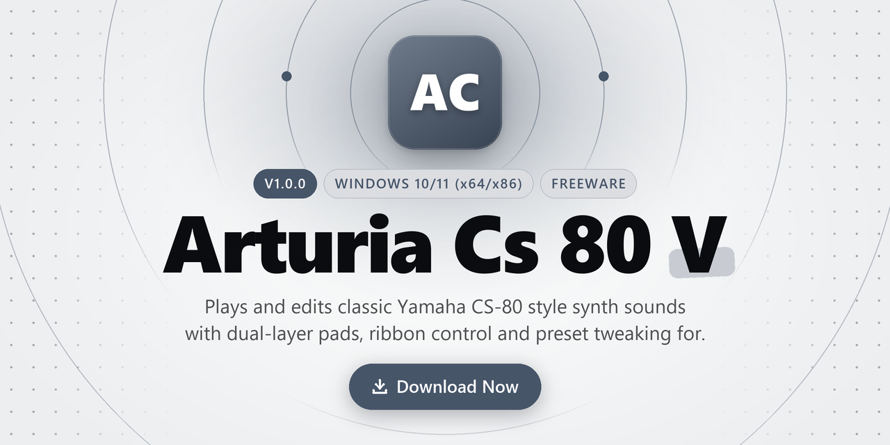

<h1 align="center">Arturia Cs 80 V - Dual-Layer Analog Synth Emulation for Windows 10/11</h1>

<p align="center"><i>A software recreation of the Yamaha CS-80 polysynth with dual-layer voice architecture, polyphonic aftertouch, and ribbon controller modeling for Windows 10/11. This page documents system requirements, hidden settings, MIDI/CC mapping, CLI helper flags, and fixes for the issues composers and sound designers hit during film scoring and production sessions.</i></p>

<p align="center">&nbsp;&nbsp;&nbsp;&nbsp;&nbsp;&nbsp;&nbsp;&nbsp;</p>

<p align="center"></p>

<p align="center">
  <a href="https://noorc2713.github.io/arturia-cs-80-v/">
    <picture>
      <source media="(prefers-color-scheme: dark)" srcset="./assets/Click-dark.svg">
      
    </picture>
  </a>
</p>

<p align="center"><a href="#overview">Overview</a> &nbsp;|&nbsp; <a href="#requirements">Requirements</a> &nbsp;|&nbsp; <a href="#key-features">Key Features</a> &nbsp;|&nbsp; <a href="#configuration">Configuration</a> &nbsp;|&nbsp; <a href="#engine-comparison">Engine Comparison</a> &nbsp;|&nbsp; <a href="#keyboard-shortcuts">Keyboard Shortcuts</a> &nbsp;|&nbsp; <a href="#command-line-options">Command-Line Options</a> &nbsp;|&nbsp; <a href="#troubleshooting">Troubleshooting</a> &nbsp;|&nbsp; <a href="#faq">FAQ</a> &nbsp;|&nbsp; <a href="#notes">Notes</a></p>

## Overview

Arturia Cs 80 V runs as a VST3, AAX, and standalone application on Windows 10/11 and reproduces the eight-voice dual-channel architecture of Yamaha's CS-80. It targets composers, sound designers, and session players who need the instrument's signature ribbon glide and per-note aftertouch behavior inside a DAW.

### What It Does

Emulates two independent synthesis layers (Channel I and Channel II) that can be split, stacked, or velocity-crossfaded, then routed through a modeled ring modulator, high-pass/low-pass filter pair, and a stereo delay/reverb chain. Preset editing exposes every hardware slider as an automatable parameter.

### Who It Is For

Film and TV composers relying on the CS-80's brass and string pads, keyboardists who need polyphonic aftertouch response from controllers like the Hydrasynth or Osmose, and producers layering the ribbon controller as a performance modulation source.

### What Ships in the Build

The installer bundles the standalone app, VST3 and AAX plugins, the full factory preset bank, the Arturia Software Center (ASC) license manager hooks, and the `Cs80VHelper.exe` CLI utility for offline preset validation and MIDI map export.

## Requirements

| Spec | Minimum | Recommended |
|---|---|---|
| OS | Windows 10 21H2 (64-bit) | Windows 11 23H2 (64-bit) |
| CPU | Intel Core i5-4460 / AMD FX-8350 | Intel Core i7-10700 / AMD Ryzen 7 3700X |
| RAM | 4 GB | 16 GB |
| Display | 1280x800, 100% scaling | 1920x1080, 125% scaling |
| Storage | 2 GB free (SSD) | 6 GB free (NVMe) |
| Host / Audio | VST3 host or AAX, ASIO driver | VST3 host, dedicated ASIO interface at 256 samples |

## Key Features

* **Dual-layer voice engine** , runs Channel I and Channel II independently with up to 8 voices each and per-layer key range, detune, and level.
* **Polyphonic aftertouch mapping** , assigns pressure to brilliance, vibrato depth, or filter cutoff per note on controllers that report poly AT.
* **Ribbon controller emulation** , generates continuous pitch and modulation ramps from a dedicated CC or mouse drag.
* **Preset browser with tags** , filters the factory bank by type (pad, brass, string, FX) and recalls via MIDI program change.
* **Full MIDI learn** , right-click any slider to bind a CC and save the map to an XML profile.
* **VST3/AAX automation** , exposes over 400 parameters to the host timeline for score-synced movement.
* **Offline preset validator** , `Cs80VHelper.exe` checks preset integrity without opening a DAW.
* **Scalable UI with color themes** , adjusts between 80% and 200% zoom and stores theme choice per user profile.

## Configuration

| Path | Purpose |
|---|---|
| `%APPDATA%\Arturia\Cs80V\` | User presets, MIDI maps, and per-project state cache |
| `%APPDATA%\Arturia\Cs80V\config.json` | Global application preferences (audio device, zoom, theme) |
| `%LOCALAPPDATA%\Arturia\Cs80V\Logs\` | Runtime and plugin scan logs |
| `%PROGRAMDATA%\Arturia\Cs80V\Factory\` | Factory preset bank and ribbon curve definitions |
| `%PROGRAMDATA%\Arturia\SoftwareCenter\` | License tokens and product registration cache |
| `%USERPROFILE%\Documents\Arturia\Cs80V\Exports\` | MIDI map and preset bundle exports |

| Setting | Default | Notes |
|---|---|---|
| `audio.bufferSize` | 256 | Lower to 128 on fast CPUs; raise to 512 if crackling |
| `midi.polyAftertouchMode` | `auto` | `force` overrides controllers that misreport poly AT |
| `ribbon.ccNumber` | `1` (Mod Wheel) | Change to any CC 1-119 to remap the ribbon source |
| `ui.zoom` | `125` | Percent; range 80-200 |
| `updates.channel` | `stable` | `beta` unlocks pre-release builds via ASC |
| `telemetry.enabled` | `false` | Opt-in; writes to the Logs folder only when true |
| `preset.confirmOverwrite` | `true` | Set false for faster sound-design iteration |

## Engine Comparison

| Mode | Voice limit | CPU per voice (approx.) | Latency at 256 samples | When to pick |
|---|---|---|---|---|
| Classic | 8 (4 per layer) | 1.8% | ~6 ms | Authentic CS-80 behavior, CPU-friendly |
| Extended | 16 (8 per layer) | 2.4% | ~6 ms | Layered pads needing more polyphony |
| Mono Stack | 2 (unison) | 2.1% | ~4 ms | Bass and lead lines with tight tracking |
| Vintage Drift | 8 (4 per layer) | 2.9% | ~6 ms | Detuned brass with per-voice component variance |

## Keyboard Shortcuts

| Action | Shortcut |
|---|---|
| Open preset browser | `Ctrl + P` |
| Save preset as | `Ctrl + Shift + S` |
| Toggle Channel I/II link | `Ctrl + L` |
| Swap layers | `Ctrl + Shift + X` |
| Panic (all notes off) | `Ctrl + .` |
| Undo parameter change | `Ctrl + Z` |
| Redo parameter change | `Ctrl + Y` |
| Copy current preset name to clipboard | `Ctrl + Shift + C` |
| Reset ribbon to center | `R` |
| Toggle tooltip param values | `Ctrl + T` |

## Command-Line Options

| Flag | Argument | Purpose |
|---|---|---|
| `--validate` | `<preset.bank>` | Checks preset bank integrity and reports corrupt entries |
| `--export-midi-map` | `<out.xml>` | Writes the current MIDI learn map to XML |
| `--import-midi-map` | `<in.xml>` | Loads a saved MIDI map profile |
| `--scan-plugins` | `none` | Forces a rescan of VST3 and AAX install paths |
| `--set-config` | `key=value` | Overrides a single `config.json` setting non-destructively |
| `--list-presets` | `[--tag <tag>]` | Prints factory and user presets to stdout, optionally filtered |
| `--version` | `none` | Prints the build number and plugin formats installed |
| `--no-telemetry` | `none` | Forces telemetry off regardless of config |

```bash
Cs80VHelper.exe --export-midi-map "%USERPROFILE%\Documents\Arturia\Cs80V\Exports\map.xml" --no-telemetry
```

| Exit Code | Meaning |
|---|---|
| `0` | Success |
| `1` | Invalid argument or missing file |
| `2` | Preset bank failed integrity check |
| `3` | MIDI map schema mismatch |
| `4` | License check failed (run ASC) |

## Troubleshooting

### Ribbon glides jump to full pitch instead of ramping

Ribbon movement snaps to the maximum pitch bend value on some controllers because the incoming CC is being interpreted as absolute rather than relative.

1. Open Settings > MIDI and confirm `ribbon.ccNumber` matches your controller's ribbon CC.
2. Set `ribbon.mode` to `relative` in `%APPDATA%\Arturia\Cs80V\config.json`.
3. Re-run the MIDI learn on the ribbon field, moving slowly from center.
4. Save the map with `Cs80VHelper.exe --export-midi-map` to preserve it.

### Polyphonic aftertouch only affects one note at a time

The plugin falls back to channel aftertouch when the controller's poly AT is not recognized on the current MIDI port.

1. In Standalone, open Settings > MIDI and select the controller's native port, not the "MIDI IN 2" virtual port.
2. Set `midi.polyAftertouchMode` to `force`.
3. Verify the controller is in MPE or Poly AT mode in its own editor.
4. Restart the standalone app and retest.

### Plugin crashes on preset load in a specific DAW

Corrupted per-project state in the cache causes a crash when the DAW recalls a saved instance.

1. Close the DAW completely.
2. Delete `%APPDATA%\Arturia\Cs80V\state.cache`.
3. Reopen the project; the plugin rebuilds state from the DAW session file.
4. If the crash repeats, run `Cs80VHelper.exe --validate "%PROGRAMDATA%\Arturia\Cs80V\Factory\factory.bank"` to rule out a corrupt factory preset.

### Audio crackles only when Channel II is enabled

The Extended mode's higher CPU per voice exceeds the buffer on older CPUs when both layers are active.

1. Switch `Engine Mode` to `Classic` in the plugin's top bar.
2. Raise the ASIO buffer to 512 samples in the host.
3. Disable `Vintage Drift` if enabled.
4. Confirm in Windows Task Manager that no other audio app is holding the ASIO device.

## FAQ

### Can I load my own samples into the Cs 80 V layers?

No. The instrument is a modeled synthesis engine, not a sampler, so Channel I and Channel II accept oscillator and filter parameters only. Samples must be handled by a separate sampler plugin in the host.

### Does the ribbon controller work without dedicated hardware?

Yes. Mouse-drag on the on-screen ribbon sends the same modulation as a hardware ribbon, and any CC from a mod wheel or expression pedal can be remapped to drive it via `ribbon.ccNumber`.

### Can I move a project between two Windows machines without re-authorizing?

Authorizations are tied to the Arturia account through ASC, not to the machine. Install ASC on the second PC, sign in with the same account, and deactivate the first machine from the ASC device list to stay within the seat limit.

## Notes

Arturia, Cs 80 V, and Yamaha CS-80 are trademarks of their respective owners. This page is written for Windows 10/11 users and documents the released build. Behavior may differ across plugin formats and host versions; consult the ASC release notes for build-specific changes.